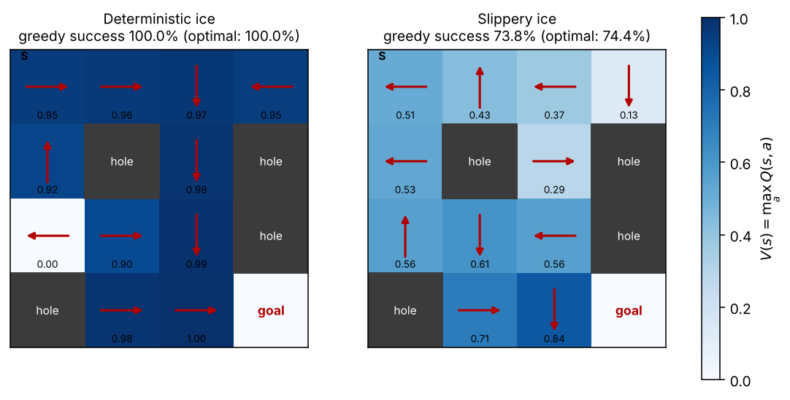
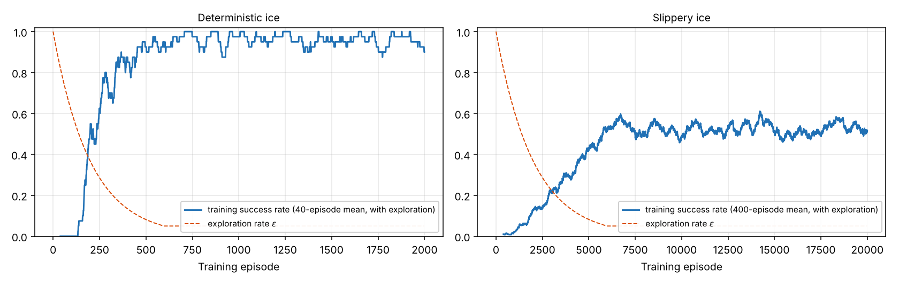

# Q-Learning on FrozenLake from Scratch

A tabular Q-learning agent written from scratch in NumPy: Q-table, ε-greedy exploration with tie-breaking, temporal-difference update, training loop and greedy evaluation. It is tested on [Gymnasium's FrozenLake 4×4](https://gymnasium.farama.org/environments/toy_text/frozen_lake/). The agent starts top-left (S) and must reach the goal without falling into a hole; the only reward is 1 at the goal.



## Results

| Environment | Training episodes | Greedy success rate (1,000 test episodes) | Best achievable |
| --- | --- | --- | --- |
| Deterministic ice | 2,000 | **100 %** | 100 % |
| Slippery ice | 20,000 | **73.8 %** | 74.4 % |

The "best achievable" column is computed independently by value iteration on the environment's known transition model: the optimal probability of reaching the goal within the 100-step episode limit. The agent never sees that model; it learns only from trial and error, yet lands within sampling error of the optimum (±1.4 % for 1,000 episodes).

### Checking the learned values against theory

On deterministic ice the optimal value is known in closed form. The only reward is 1 at the goal, and the shortest path from S takes 6 moves, so

$$Q^\*(S, a^\*) = \gamma^{5} = 0.99^{5} = 0.9510$$

which is exactly the value learned by the agent. Each step closer to the goal multiplies by 1/γ, which is why the values on the left map grow from 0.95 to 1.00 along the path. The cell at 0.00 is never visited by the greedy path, so its arrow is meaningless.

### Why the slippery policy looks strange

On slippery ice, the chosen move happens only 1/3 of the time; otherwise the agent slides to one of the two perpendicular directions. The learned policy exploits this:

- At the start it pushes **left, into the wall**. The only possible outcomes are then staying put or sliding down, so it can never slide right towards the holes.
- Next to a hole it picks the action whose two perpendicular slips also avoid the hole, even if that means moving away from the goal for a while.

Safety beats speed, which the value scale shows: V(S) drops from 0.95 to 0.51.



The training curves include exploration (ε never drops below 0.05), which is why they stay below the greedy test success rates in the table.

## What is implemented (`model.py`)

| Block | Functions |
| --- | --- |
| Q-table and action selection | `init_q_table`, `max_q_value`, `greedy_action`, `sample_random_action`, `should_explore`, `epsilon_greedy_action` (random tie-breaking among maximal actions), `decay_epsilon` |
| Learning rule | `td_target` (no bootstrap on terminal states), `td_error`, `q_learning_update`: Q(s,a) ← Q(s,a) + α [r + γ maxₐ' Q(s',a') − Q(s,a)] |
| Training and evaluation | `interaction_step`, `run_training_episode`, `train_q_learning`, `extract_greedy_policy`, `run_greedy_episode`, `evaluate_success_rate` |

## Run it

```bash
pip install -r requirements.txt
python scaffold.py      # train on deterministic ice, print diagnostics
python visualize.py     # both environments, figures and optimal-policy check (~1.5 min); --show to display
```

## Files

```
model.py       my implementation (16 functions)
visualize.py   learning curves, value/policy maps, comparison with the optimal policy
scaffold.py    driver provided with the exercise
figures/       generated plots
```

---
Guided project from [Deep-ML](https://www.deep-ml.com): the step-by-step structure and `scaffold.py` come from the exercise; every function in `model.py` is my own solution.
